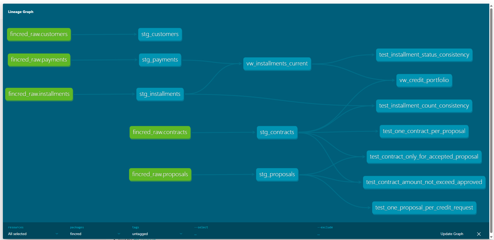
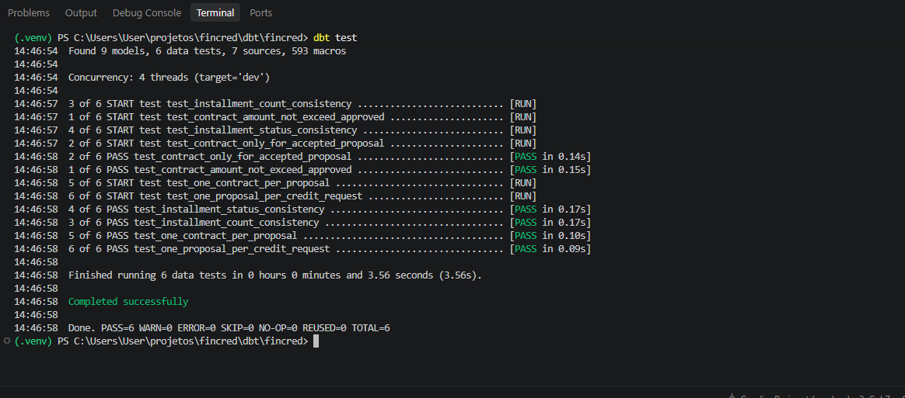
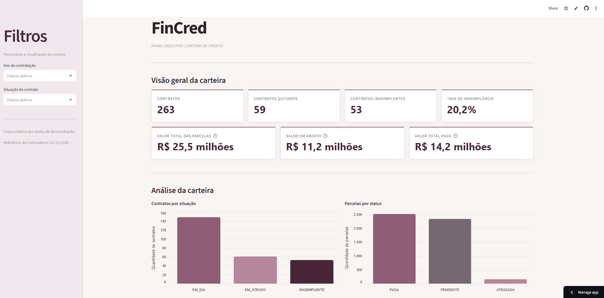

# FinCred

**Projeto de Analytics Engineering para uma fintech fictícia de crédito B2B.**

O FinCred é um projeto de dados ponta a ponta, desenvolvido com foco na transformação de dados brutos de operações de crédito em informações confiáveis para análise de carteira e acompanhamento de risco de crédito.

O projeto contempla transformação de dados, aplicação de regras de negócio, validação da qualidade dos dados e desenvolvimento de um dashboard executivo para acompanhamento dos indicadores da carteira.

**[Acessar o dashboard](https://fincred-dashboard.streamlit.app/)**

## Arquitetura e tecnologias

O projeto utiliza uma arquitetura organizada em camadas, com separação entre dados brutos, transformações e modelos analíticos.

### Stack tecnológica

| Tecnologia | Aplicação no projeto |
|---|---|
| PostgreSQL | Banco de dados utilizado para armazenamento dos dados. |
| dbt Core | Transformação dos dados, organização dos modelos e testes de qualidade. |
| Python | Linguagem utilizada no desenvolvimento do dashboard. |
| Pandas | Manipulação e preparação dos dados para visualização. |
| Streamlit | Desenvolvimento e publicação do dashboard interativo. |
| Git e GitHub | Versionamento e gerenciamento do código-fonte. |

### Fluxo de dados

1. **Raw:** armazenamento dos dados brutos no PostgreSQL.
2. **Staging:** padronização e preparação dos dados por meio de modelos dbt.
3. **Marts:** aplicação de regras de negócio e consolidação dos dados em modelos analíticos.
4. **Dashboard:** consumo das views exportadas em CSV pelo Streamlit para apresentação dos indicadores.

O dashboard está publicado no Streamlit Community Cloud e utiliza uma cópia estática dos dados exportados, sem conexão direta com o PostgreSQL.

## Transformações e regras de negócio

As transformações foram desenvolvidas com dbt Core, organizando os modelos em duas camadas:

- **Staging:** preparação, padronização e organização dos dados provenientes das tabelas raw.
- **Marts:** consolidação das informações e aplicação das regras de negócio para disponibilizar dados analíticos.

### Principais regras de negócio

- **Classificação de parcelas:** identificação das parcelas como pagas, pendentes ou atrasadas, considerando a existência de pagamento e a data de vencimento.
- **Comportamento de pagamento:** classificação dos pagamentos como antecipados, realizados em dia ou em atraso.
- **Classificação da carteira:** segmentação dos contratos em dia, atrasados ou inadimplentes, considerando a situação das parcelas em aberto.
- **Quitação de contratos:** identificação de contratos quitados com base na quantidade total de parcelas e na quantidade de parcelas pagas.

## Qualidade de dados

Foram implementados testes de qualidade com dbt Core para validar a consistência e a integridade dos dados ao longo das transformações.

O projeto conta com **6 testes customizados**, voltados à identificação de inconsistências relacionadas às regras de negócio e aos relacionamentos entre as entidades.

Todos os testes foram executados com sucesso:

- 6 testes aprovados (PASS)
- Nenhum teste com aviso ou erro (WARN / ERROR)

### Evidências

## Dashboard

O dashboard executivo foi desenvolvido em Python com Streamlit, permitindo acompanhar indicadores da carteira de crédito e analisar sua composição.

Entre os indicadores e análises disponíveis estão:

- Volume total da carteira de crédito.
- Quantidade de contratos.
- Ticket médio.
- Distribuição da carteira por status.
- Evolução e composição dos contratos por modalidade.

**[Acessar o dashboard publicado](https://fincred-dashboard.streamlit.app/)**